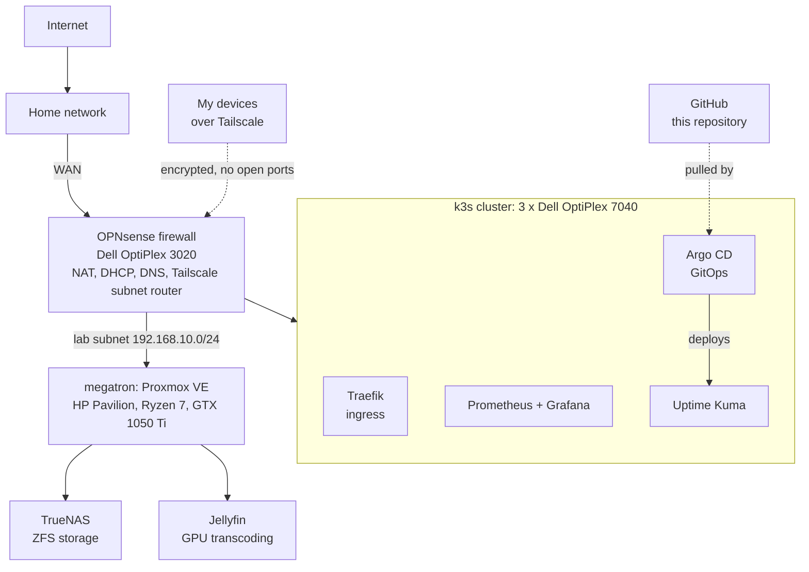

# Homelab

# 🏠 Home Lab Infrastructure

> An on-premises, self-hosted infrastructure platform built on bare metal — segmented behind an OPNsense firewall, running a Proxmox virtualization environment and a k3s Kubernetes cluster deployed through GitOps with Argo CD, with full observability and zero-trust remote access.

This repository is the **hub** for my home lab. It documents the underlying platform — hardware, networking, virtualization, and orchestration — that everything else runs on. Kubernetes workloads are documented here under [kubernetes/](kubernetes), alongside the manifests Argo CD deploys them from. Larger projects live in their own repositories and link back here (see [Projects](#-projects-running-on-this-lab)).

---

## 📌 Overview

This lab is a hands-on environment for practicing **infrastructure, networking, virtualization, container orchestration, observability, and DevSecOps** — the same disciplines I work in professionally. It is designed to mirror production patterns at a small scale: network segmentation, least-privilege access, monitoring, and infrastructure-as-code.

**Key capabilities:**
- 🔥 **Network segmentation** — the lab is isolated behind an OPNsense edge firewall with its own subnet, NAT, DHCP, and DNS
- 🖥️ **Virtualization** — a Proxmox VE hypervisor hosting VMs and LXC containers
- ☸️ **Container orchestration** — an on-prem k3s Kubernetes cluster with dynamic NFS-backed storage
- 🐙 **GitOps** — Argo CD deploys workloads from this repository; a `git push` is what changes the cluster
- 🚦 **Ingress and DNS** — Traefik routes by hostname, with a wildcard DNS record so new services need no DNS change
- 📊 **Observability** — Prometheus + Grafana for metrics, dashboards, and cluster health, plus Uptime Kuma for uptime checks
- 🔐 **Zero-trust remote access** — Tailscale (WireGuard mesh) for secure access from anywhere, no ports exposed to the internet
- 💾 **Network storage** — TrueNAS serving ZFS-backed NFS shares to the cluster and media services

---

## 🗂️ Repository Layout

| Folder | Contents |
|---|---|
| [hardware/](hardware/README.md) | The physical machines and what each one is used for |
| [network/](network/README.md) | Subnets, OPNsense, DNS and Tailscale remote access |
| [kubernetes/apps/](kubernetes/apps) | One folder per app deployed on the cluster, with its manifests. Argo CD deploys from here |
| [kubernetes/argocd/](kubernetes/argocd/README.md) | The Argo CD install and how it manages the apps |
| [kubernetes/monitoring/](kubernetes/monitoring/README.md) | The Prometheus and Grafana stack: Helm values, components and what is scraped |

---

## 🗺️ Architecture

---

## 🖥️ Hardware

| Host | Role | Model | CPU | RAM | Storage |
|---|---|---|---|---|---|
| `jayden1` | k3s control plane | Dell OptiPlex 7040 | Intel Core i5-6500T | 8 GB | 256 GB SSD |
| `jayden2` | k3s worker | Dell OptiPlex 7040 | Intel Core i5-6500T | 8 GB | 256 GB SSD |
| `jayden3` | k3s worker | Dell OptiPlex 7040 | Intel Core i5-6500T | 8 GB | 256 GB SSD |
| `megatron` | Proxmox VE hypervisor | HP Pavilion desktop | AMD Ryzen 7, 5000 series | 16 GB | 1 TB |
| OPNsense | Firewall and router | Dell OptiPlex 3020 | Intel Core i3 | 8 GB | 256 GB |

Full details are in [hardware/](hardware/README.md).

---

## 🧰 Tech Stack

| Layer | Technology |
|---|---|
| **Firewall / Routing** | OPNsense (BSD-based) |
| **Virtualization** | Proxmox VE |
| **Network Storage** | TrueNAS (ZFS) over NFS |
| **Orchestration** | k3s (lightweight Kubernetes) |
| **Package Management** | Helm |
| **GitOps / Continuous Delivery** | Argo CD |
| **Ingress** | Traefik |
| **DNS** | Unbound on OPNsense (wildcard for lab services), CoreDNS inside the cluster |
| **Persistent Storage** | nfs-subdir-external-provisioner (dynamic NFS PVCs) |
| **Monitoring** | Prometheus, Grafana, Uptime Kuma |
| **Remote Access** | Tailscale (WireGuard mesh VPN) |
| **Media Server** | Jellyfin |

---

## 🌐 Network Design

The lab sits **behind** the primary/family network on a dedicated segment, enforcing isolation between lab infrastructure and the rest of the home.

- **WAN:** OPNsense uplinks to the upstream network (double-NAT by design)
- **LAN:** `192.168.10.0/24` — the isolated lab subnet
- **Gateway / DNS:** OPNsense
- **Addressing:** static assignments / DHCP reservations for infrastructure hosts
- **Remote access:** Tailscale advertises the lab subnet, allowing secure access to any host from anywhere without exposing ports to the internet

**Firewall approach:** default-deny inbound from WAN, with explicit rules governing what the lab can reach — practicing least-privilege segmentation.

---

## 🐙 GitOps

Workloads on the cluster are deployed by [Argo CD](kubernetes/argocd/README.md), not by hand.

- Each app has a folder of Kubernetes manifests under [kubernetes/apps/](kubernetes/apps).
- Argo CD runs inside the cluster, watches this repository, and applies any change pushed to `main`.
- It pulls from GitHub, so nothing outside the lab needs credentials for the cluster or a route into it.
- Manual changes to managed objects are reverted to match Git, which keeps this repository an accurate record of what is running.

Argo CD itself is installed with Helm and reached through Traefik at a `.home.lan` hostname.

---

## 💾 Storage

- **TrueNAS** manages a ZFS pool and exports it over **NFS**.
- **Jellyfin** and the k3s cluster consume media/storage from the same NFS export, ensuring consistent paths (important for hardlink-based media workflows).
- **k3s** uses the `nfs-subdir-external-provisioner` to dynamically provision `ReadWriteMany` PersistentVolumes backed by NFS.

---

## 📊 Observability

- **Prometheus** scrapes cluster and node metrics.
- **Grafana** provides dashboards for cluster health, resource utilization, and workload monitoring.
- **[Uptime Kuma](kubernetes/apps/uptime-kuma/README.md)** checks that services respond and keeps their uptime history.

---

## 🔐 Remote Access

- **Tailscale** runs on OPNsense as a subnet router, advertising `192.168.10.0/24`.
- Provides encrypted (WireGuard) access to the entire lab from any device on my tailnet — **no inbound ports opened** on the network.
- Route approval and interface firewall rules scope what the tailnet can reach.

---

## 🔗 Projects Running on This Lab

Each project below is deployed on this infrastructure. Some are documented in this repository and others live in their own:

| Project | Description | Location |
|---|---|---|
| **Argo CD** | GitOps controller installed with Helm; deploys the apps in this repository automatically | [kubernetes/argocd](kubernetes/argocd/README.md) |
| **Uptime Kuma** | Uptime monitoring deployed from hand-written manifests: Deployment, PVC, Service and Ingress | [kubernetes/apps/uptime-kuma](kubernetes/apps/uptime-kuma/README.md) |
| **Media Automation Stack** | Containerized media pipeline (Sonarr, Radarr, Prowlarr, qBittorrent, Jellyseerr) on k3s with automated malware scanning (ClamAV) | _link_ |
| **Monitoring Stack** | Prometheus + Grafana deployment, dashboards, and alert rules | [kubernetes/monitoring](kubernetes/monitoring/README.md) |
| _more coming_ | | |

> Each spoke repo links back here for full infrastructure context.

---

## 📚 What I Learned / Demonstrated

- Bare-metal firewall deployment and network segmentation with OPNsense
- Diagnosing and resolving low-level networking issues (NIC/driver, routing, NAT, ARP)
- Migrating an entire cluster to a new subnet and recovering NFS storage mounts
- Kubernetes storage provisioning and Helm-based application deployment on k3s
- Building a monitoring/observability stack from scratch
- Writing Kubernetes manifests by hand: Deployments, PersistentVolumeClaims, Services and Ingresses
- GitOps with Argo CD: adopting a running workload, automated sync and self-healing
- Hostname-based ingress with Traefik and wildcard DNS
- Implementing zero-trust remote access with WireGuard/Tailscale
- Virtualization management with Proxmox (VMs, LXC, storage passthrough)

---

## 📄 License

Personal project — documentation shared for reference and portfolio purposes.
