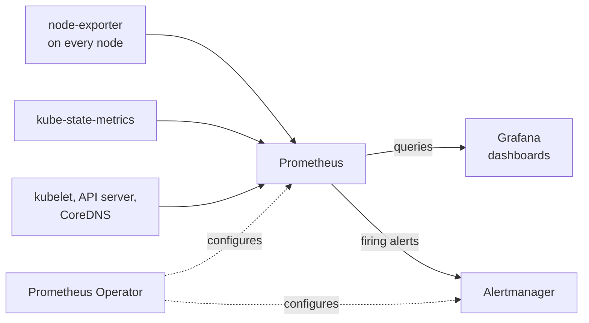

# 📊 Monitoring: Prometheus and Grafana

> Metrics, dashboards and alert rules for the k3s cluster, installed as one Helm release of the kube-prometheus-stack chart.

This project is part of my [Homelab](../../README.md). It was the first thing I installed on the cluster with Helm, before [Argo CD](../argocd/README.md) and [Uptime Kuma](../apps/uptime-kuma/README.md).

---

## 📌 Overview

| | |
|---|---|
| **Chart** | `prometheus-community/kube-prometheus-stack` `88.1.5` |
| **Release** | `monitoring`, in the `monitoring` namespace |
| **Installed with** | Helm, one revision, running since August 2026 |
| **Managed by Argo CD** | Not yet; this release is installed directly |

One chart installs the whole stack and wires the pieces together, so Prometheus already scrapes the cluster and Grafana already has dashboards on first start.

---

## 🧱 Components

| Component | Runs as | Version | Job |
|---|---|---|---|
| **Prometheus Operator** | Deployment | `v0.93.0` | Turns `Prometheus`, `ServiceMonitor` and `PrometheusRule` objects into a running, configured Prometheus |
| **Prometheus** | StatefulSet | `v3.13.2` | Scrapes metrics and stores them as time series |
| **Alertmanager** | StatefulSet | `v0.33.1` | Receives alerts fired by Prometheus rules and routes them |
| **Grafana** | Deployment | `13.1.2` | Dashboards on top of the Prometheus data |
| **node-exporter** | DaemonSet, one pod per node | `v1.12.1` | Hardware and operating system metrics for each node |
| **kube-state-metrics** | Deployment | `v2.19.1` | Metrics about Kubernetes objects, such as Deployment replicas and pod status |



---

## 🚀 Installation

```bash
helm repo add prometheus-community https://prometheus-community.github.io/helm-charts
helm repo update

helm install monitoring prometheus-community/kube-prometheus-stack \
  --version 88.1.5 \
  --namespace monitoring --create-namespace \
  -f values.yaml \
  --set grafana.adminPassword=<password>
```

The Grafana admin password is passed on the command line and is deliberately not in [values.yaml](values.yaml), so it never reaches this repository.

### Values

| Setting | Value | Why |
|---|---|---|
| `grafana.persistence` | Enabled, 2Gi on `local-path` | Dashboards and settings made in the interface survive a pod restart |
| `prometheus.prometheusSpec.retention` | `15d` | Keeps two weeks of metrics, which bounds disk use |
| `prometheus.prometheusSpec.storageSpec` | 20Gi on `local-path`, `ReadWriteOnce` | Metrics are kept on a volume instead of inside the pod |

Everything else is the chart's default.

---

## 🎯 What Is Scraped

Prometheus finds its targets through `ServiceMonitor` objects. The chart creates 13 of them.

| Job | Targets | What it reports |
|---|---|---|
| `node-exporter` | 3 | CPU, memory, disk and network for each node |
| `kubelet` | 9 | Container and pod resource usage, three endpoints per node |
| `apiserver` | 1 | Kubernetes API request rates and latency |
| `coredns` | 1 | Cluster DNS queries |
| `kube-state-metrics` | 1 | State of Deployments, pods, PVCs and other objects |
| Prometheus, Alertmanager, Grafana, the operator | 6 | The monitoring stack watching itself |

The chart also ships 35 `PrometheusRule` objects with alert and recording rules, and 29 Grafana dashboards covering nodes, pods, namespaces and the control plane.

The machine details in [hardware/](../../hardware/README.md) came from this data: node-exporter reports each node's model, memory and disks.

---

## 🌐 Access

Both interfaces are exposed as `NodePort` Services, reachable on any cluster node from the lab network or the tailnet.

| Interface | Port |
|---|---|
| Grafana | `32537` |
| Prometheus | `31939` |

Grafana's `/api/health` endpoint is checked every minute by [Uptime Kuma](../apps/uptime-kuma/README.md).

---

## 💾 Storage and Resource Use

| Volume | Size | Used by |
|---|---|---|
| Prometheus data | 20Gi | Time series, 15 days of retention |
| Grafana data | 2Gi | Dashboards, users and settings |

Both are `local-path` volumes, so each is tied to the node it was created on.

| Pod | Memory in use |
|---|---|
| Prometheus | about 660 MB |
| Grafana | about 560 MB |
| Operator, Alertmanager and kube-state-metrics | about 200 MB together |
| node-exporter | about 25 MB per node |

The stack uses roughly 1.5 GB of the cluster's 24 GB of memory.

---

## ⚠️ Known Limitations

- **Reached by port, not hostname.** It was installed before the Traefik Ingress setup, so there is no `grafana.home.lan` yet.
- **Data is tied to one node.** With `local-path`, losing that node's disk loses the metrics history and the Grafana settings.
- **Not in GitOps.** Upgrades are run by hand with `helm upgrade`.

---

## 🔭 Next Steps

- [ ] Ingress hostnames for Grafana and Prometheus, replacing the node ports
- [ ] A `ServiceMonitor` for Uptime Kuma's `/metrics` endpoint, with a Grafana dashboard for it
- [ ] Alertmanager notifications to Discord
- [ ] Move the release under Argo CD

---

## 📚 What I Learned

- How the Prometheus Operator works: describing monitoring with `ServiceMonitor` and `PrometheusRule` objects instead of editing a Prometheus config file
- The difference between node-exporter (the machine) and kube-state-metrics (the Kubernetes objects)
- Sizing retention and storage together so Prometheus does not fill its volume
- Keeping a secret out of a values file by passing it at install time
