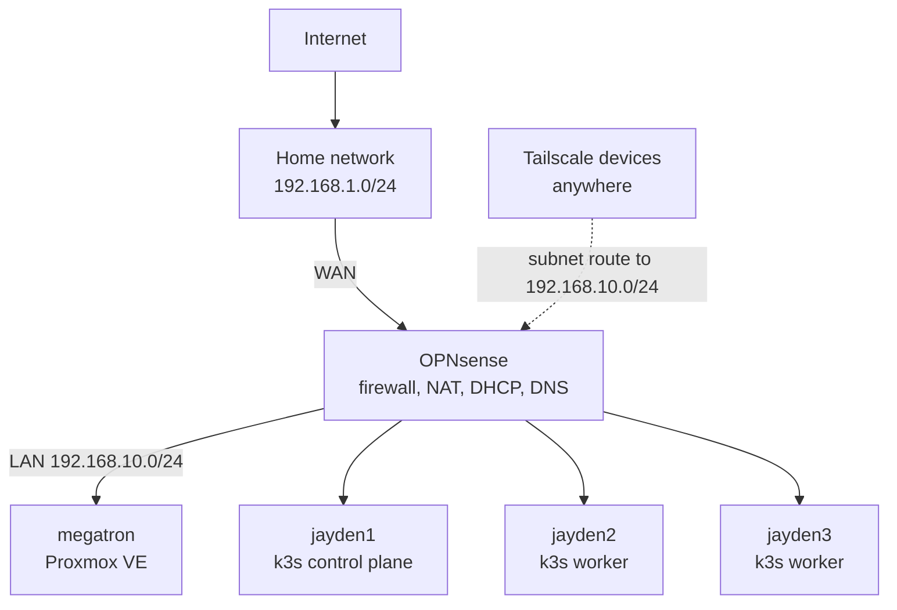
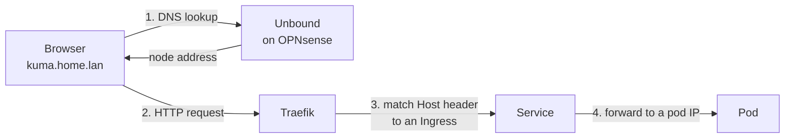

# 🌐 Network

> How the homelab is segmented, addressed and reached: an isolated subnet behind OPNsense, wildcard DNS for cluster services, and remote access over Tailscale with no open ports.

This section is part of the [Homelab](../README.md). The machines themselves are listed under [hardware](../hardware/README.md).

---

## 🗺️ Topology

The lab sits behind the home network on its own subnet. OPNsense is the only path in or out, so the lab is double-NATed by design and isolated from the rest of the house.

---

## 📍 Addressing

| Network | Range | Gateway and DNS |
|---|---|---|
| Home | `192.168.1.0/24` | Home router |
| Lab | `192.168.10.0/24` | OPNsense |

| Host | Role |
|---|---|
| OPNsense | Firewall, router, DHCP, DNS, Tailscale subnet router |
| `megatron` | Proxmox VE hypervisor |
| `jayden1` | k3s control plane |
| `jayden2` | k3s worker |
| `jayden3` | k3s worker |

Infrastructure hosts use fixed addresses on the lab subnet. Individual addresses are left out of this public repository.

---

## 🔤 DNS

OPNsense runs Unbound as the resolver for the lab. Two kinds of names matter.

| Names | Resolved by | Points at |
|---|---|---|
| `*.home.lan` | Unbound wildcard host override | The control-plane node, where Traefik listens |
| Cluster-internal names, such as `monitoring-grafana.monitoring.svc.cluster.local` | CoreDNS inside the cluster | The Service's cluster IP |

The wildcard means a new service needs no DNS change. Any hostname ending in `.home.lan` already reaches Traefik, and the Ingress for that hostname decides which app gets the request.

### Services by hostname

| Hostname | Service |
|---|---|
| `kuma.home.lan` | [Uptime Kuma](../kubernetes/apps/uptime-kuma/README.md) |
| `argocd.home.lan` | [Argo CD](../kubernetes/argocd/README.md) |

---

## 🔐 Remote Access

Tailscale gives encrypted access to the lab from any of my devices, with no ports forwarded on either router.

| Setting | Where | Effect |
|---|---|---|
| Subnet router advertising `192.168.10.0/24` | OPNsense | Tailnet devices can reach every lab address |
| Split DNS: OPNsense as the nameserver, restricted to `home.lan` | Tailscale admin console | Tailnet devices send `.home.lan` lookups to OPNsense and everything else to their normal resolver |

On Windows, `nslookup` ignores the per-domain rule Tailscale installs and reports `.home.lan` names as missing. `ping` and browsers use the system resolver and work.

---

## ☸️ Cluster Networking

| | |
|---|---|
| **CNI** | Flannel (k3s default) |
| **Pod network** | `10.42.0.0/16`, one `/24` per node |
| **Service network** | `10.43.0.0/16` |
| **Cluster DNS** | CoreDNS at `10.43.0.10` |
| **Ingress controller** | Traefik, exposed on ports 80 and 443 of every node by the k3s service load balancer |

### How a request reaches an app

Traefik picks the app from the hostname in the request, not from a port, which is why every service can share ports 80 and 443.

### Still on a node port

These were installed before the Ingress setup and are reached by port on any node.

| Service | Port |
|---|---|
| Grafana | `32537` |
| Prometheus | `31939` |

---

## 📝 History

The cluster first ran on the home network and was later moved behind OPNsense onto `192.168.10.0/24`. After the move, both workers stayed `NotReady` because each k3s agent still had the control plane's old address saved. The diagnosis and fix are written up in the [Uptime Kuma project](../kubernetes/apps/uptime-kuma/README.md#-troubleshooting-along-the-way).

---

## ⚠️ Known Limitations

- **The wildcard record points at one node.** Traefik listens on all three, but if `jayden1` is down the hostnames stop resolving to a working address.
- **HTTP only.** No service has a TLS certificate yet.
- **No network policies.** Every pod can reach every other pod.

---

## 🔭 Next Steps

- [ ] A floating virtual IP for Traefik (kube-vip or MetalLB), so the wildcard record does not depend on one node
- [ ] Move Grafana and Prometheus behind Ingress hostnames
- [ ] NetworkPolicies to restrict traffic between namespaces
- [ ] TLS for the `.home.lan` services
