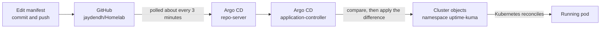

# 🐙 Argo CD on k3s

> GitOps for my homelab: Argo CD installed with Helm, exposed through Traefik, and set to deploy Uptime Kuma automatically from this repository.

This project is part of my [Homelab](../../README.md). It follows the [Uptime Kuma](../uptime-kuma/README.md) project, where I wrote the manifests by hand and applied them with `kubectl`. Here I handed that job to Argo CD, so a `git push` is now what deploys a change.

---

## 📌 Overview

[Argo CD](https://argo-cd.readthedocs.io/) runs inside the cluster, watches a Git repository, and keeps the cluster matching the manifests in it. It pulls from Git, so nothing outside the lab needs credentials for the cluster or a route into it.

| | |
|---|---|
| **Cluster** | k3s `v1.36.2+k3s1`, 1 control-plane node and 2 workers |
| **Argo CD** | `v3.5.4` |
| **Installed with** | Helm `v4.3.0`, chart `argo/argo-cd` `10.10.2` |
| **Namespace** | `argocd` |
| **URL** | `http://argocd.home.lan` (lab network and tailnet only) |
| **Managing** | [projects/uptime-kuma](../uptime-kuma) |

---

## 🗺️ How It Works



There are two layers of "make reality match the description". Argo CD makes the cluster's objects match Git, and Kubernetes makes the running pods match those objects.

---

## 🧱 What the Chart Installs

| Component | Kind | Job |
|---|---|---|
| `argocd-server` | Deployment | Web interface and API |
| `argocd-repo-server` | Deployment | Fetches Git repositories and renders the manifests in them |
| `argocd-application-controller` | StatefulSet | Compares the cluster with Git and syncs it |
| `argocd-applicationset-controller` | Deployment | Generates Applications from a template |
| `argocd-redis` | Deployment | Cache shared by the other components |
| `argocd-dex-server` | Deployment | Optional single sign-on |
| `argocd-notifications-controller` | Deployment | Alerts about sync events |

---

## 🚀 Installation

### 1. Add the chart repository

```bash
helm repo add argo https://argoproj.github.io/argo-helm
helm repo update
```

### 2. Install with the chart defaults

```bash
helm install argocd argo/argo-cd --namespace argocd --create-namespace
```

This gave a working Argo CD as release revision 1, but with only `ClusterIP` Services. The chart ships with its Ingress switched off, so there was no hostname yet.

### 3. Add an Ingress with a values file

[values.yaml](values.yaml) holds only the settings that differ from the chart's defaults:

```yaml
global:
  domain: argocd.home.lan

configs:
  params:
    server.insecure: true

server:
  ingress:
    enabled: true
    ingressClassName: traefik
```

| Setting | Why |
|---|---|
| `global.domain` | The hostname for the web interface; the chart uses it as the Ingress host |
| `server.ingress.enabled` | Creates the Ingress, which is off by default |
| `server.ingress.ingressClassName` | Hands the Ingress to Traefik, the controller bundled with k3s |
| `configs.params."server.insecure"` | Makes the server speak plain HTTP. By default it serves HTTPS and redirects HTTP to it, which loops when Traefik talks HTTP to it |

### 4. Apply the values to the running release

```bash
helm upgrade argocd argo/argo-cd -n argocd -f values.yaml
```

Helm rendered the chart again, created the Ingress, restarted the server with the new parameter, and recorded revision 2.

```
REVISION  STATUS      CHART            DESCRIPTION
1         superseded  argo-cd-10.10.2  Install complete
2         deployed    argo-cd-10.10.2  Upgrade complete
```

The hostname needed no DNS change, because OPNsense already resolves `*.home.lan` to the cluster (see the [DNS section](../uptime-kuma/README.md#-dns) of the Uptime Kuma project).

### 5. First login

The chart generates a random `admin` password and stores it in a Secret. This copies it to the Windows clipboard:

```bash
kubectl get secret argocd-initial-admin-secret -n argocd \
  -o jsonpath="{.data.password}" | base64 -d | clip
```

After signing in I set my own password under **User Info > Update Password**.

---

## 📦 The Application

An Application tells Argo CD which folder of which repository to deploy, and where. I created this one in the web interface; as a manifest it is:

```yaml
apiVersion: argoproj.io/v1alpha1
kind: Application
metadata:
  name: uptime-kuma
  namespace: argocd
spec:
  project: default
  source:
    repoURL: https://github.com/jaydendh/Homelab.git
    targetRevision: main
    path: projects/uptime-kuma
  destination:
    server: https://kubernetes.default.svc
    namespace: uptime-kuma
  syncPolicy:
    automated:
      enabled: true
      selfHeal: true
      prune: false
```

The two namespaces mean different things. `metadata.namespace` is where the Application object itself lives, which has to be `argocd`. `destination.namespace` is where the app's own objects are deployed.

The repository is public, so no credentials were needed. `path` limits Argo CD to that one folder, and it ignores non-YAML files such as the README.

### Adopting a workload that was already running

Uptime Kuma had been deployed with `kubectl apply` before Argo CD existed. The new Application reported `Healthy` but `OutOfSync` for all four objects, even though `kubectl diff` between the repository and the cluster showed no differences.

The cause was Argo CD's tracking annotation, which marks the objects an Application owns and which the existing objects did not have. The first sync added it and changed nothing else: the pod was not restarted and the PersistentVolumeClaim stayed bound to the same volume.

### Sync policy

| Option | Setting | Reason |
|---|---|---|
| Automated sync | On | A push to `main` deploys without pressing Sync |
| Self heal | On | Manual changes to managed objects are reverted to match Git |
| Prune | Off | Removing a manifest from Git does not delete the object. The PVC holds data with no backup, so deletion stays a manual decision |

---

## ✅ First Change Through Git

To prove the loop, I added resource requests and limits to the Uptime Kuma Deployment and pushed, without running `kubectl apply`.

| Time (UTC) | Event |
|---|---|
| 18:53:59 | Commit `a027ea4` pushed to `main` |
| about 18:55 | Argo CD detected the new commit and started an automated sync |
| 18:55:56 | Sync succeeded |
| 18:56:03 | New pod running and completing its first monitor check |

The old pod was stopped before the new one started, because the Deployment uses the `Recreate` strategy. The new pod mounted the same volume, so the account and monitors were still there.

---

## 🔧 Troubleshooting Along the Way

**Login rejected with the generated password.** The password prints with no trailing newline, so it runs into the shell prompt and is easy to copy with extra characters. Piping the output to `clip` avoids selecting it by hand.

**Pods stuck in `ContainerCreating` after install.** Each node pulls the Argo CD image, about 220 MB, the first time it runs a pod that needs it, which took a little over two minutes per node. `helm install` reports `deployed` once the objects are applied, not once the pods are up, so `kubectl get pods` is still the check.

**One `ErrImagePull` on the dex pod.** A DNS lookup failed during the first pull and the automatic retry succeeded.

---

## ⚠️ Known Limitations

- **HTTP only.** The Ingress has no TLS certificate, so the login is not encrypted in transit. Access is limited to the lab network and tailnet.
- **The Application is not in Git.** It was created in the web interface, so it would have to be recreated by hand on a new cluster.
- **Only one app is managed.** The monitoring stack and Argo CD itself are still installed directly with Helm.

---

## 🔭 Next Steps

- [ ] TLS with cert-manager
- [ ] Store the Application in Git, then replace it with an ApplicationSet that creates one Application per folder under `projects/`
- [ ] Bring the monitoring stack under Argo CD
- [ ] Remove the generated `argocd-initial-admin-secret`

---

## 📚 What I Learned

- What a Helm chart is: templated manifests plus default values, installed and tracked as a release
- The Helm lifecycle: `repo add`, `show values`, `template`, `install`, `upgrade`, `history`, `rollback`
- Why a values file holds only overrides, and how `helm upgrade` applies them to a running release
- How Secrets store values base64-encoded, and how to read one with `jsonpath`
- The difference between push-based deployment (a pipeline running `kubectl`) and pull-based GitOps
- What an Application is, and why its own namespace differs from its destination namespace
- How Argo CD adopts existing objects, and what `Synced`, `OutOfSync` and `Healthy` mean
- The trade-offs of automated sync, self heal and prune
