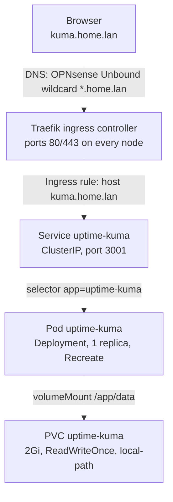

# 📈 Uptime Kuma on k3s

> A self-hosted uptime monitor deployed to my 3-node k3s cluster from hand-written Kubernetes manifests, reachable by hostname through Traefik with lab-wide DNS.

This project is part of my [Homelab](../../README.md). It was my first workload deployed without a Helm chart: I wrote each manifest myself to learn what a Deployment, PersistentVolumeClaim, Service and Ingress do and how they connect.

---

## 📌 Overview

[Uptime Kuma](https://github.com/louislam/uptime-kuma) checks on a schedule whether services respond and records their uptime history. In this lab it watches the other services on the cluster, starting with Grafana.

| | |
|---|---|
| **Cluster** | k3s `v1.36.2+k3s1`, 1 control-plane node and 2 workers, Ubuntu 26.04 |
| **App** | Uptime Kuma `2.5.6` (image `louislam/uptime-kuma:2`) |
| **Ingress controller** | Traefik `3.7` (bundled with k3s) |
| **Storage** | `local-path` StorageClass (bundled with k3s) |
| **URL** | `http://kuma.home.lan` (lab network and tailnet only) |

---

## 🗺️ Architecture



Each object answers one question:

| Object | File | Question it answers |
|---|---|---|
| Deployment | [deployment.yaml](deployment.yaml) | What runs, and how many copies? |
| PersistentVolumeClaim | [pvc.yaml](pvc.yaml) | Where does its data live? |
| Service | [service.yaml](service.yaml) | How do other things in the cluster reach it? |
| Ingress | [ingress.yaml](ingress.yaml) | How is it reached from outside the cluster? |

---

## 🚀 Deploying

The namespace is created first, then every manifest in this folder is applied.

```bash
kubectl create namespace uptime-kuma
kubectl apply -f .
```

Checking the result:

```bash
kubectl get deploy,pods,pvc,svc,ingress -n uptime-kuma
kubectl get endpointslices -n uptime-kuma   # should list the pod IP on port 3001
```

Routing can be tested before any DNS exists by sending the hostname by hand. A `302` to `/setup-database` on first run means Traefik matched the rule and reached the app:

```bash
curl -I -H "Host: kuma.home.lan" http://192.168.10.245/
```

---

## 🧩 Design Decisions

- **One replica with the `Recreate` strategy.** Uptime Kuma keeps everything in a single SQLite file. The default rolling update starts the new pod before stopping the old one, which would briefly put two writers on that file. `Recreate` stops the old pod first, at the cost of a few seconds of downtime per update.
- **`ReadWriteOnce` on `local-path`.** The volume is a folder on one node's disk, so only that node can mount it. The claim stays `Pending` until a pod uses it, because the provisioner waits to learn which node to create the folder on.
- **`ClusterIP` Service plus an Ingress, not a NodePort.** The app is exposed by hostname on the standard web ports through Traefik, so no per-app port has to be remembered.
- **Its own namespace.** Everything for the app is grouped together and kept apart from system and monitoring workloads.

---

## 🌐 DNS

The hostname has to resolve to a node running Traefik. Two settings make that work for every device that can reach the lab, with no per-device hosts file.

| Where | Setting | Effect |
|---|---|---|
| **OPNsense** (Unbound DNS, host override) | `*.home.lan` → `192.168.10.245` | Every `.home.lan` name points at Traefik; a new app only needs an Ingress |
| **Tailscale** (split DNS) | Nameserver `192.168.10.1`, restricted to `home.lan` | Devices on the tailnet send `.home.lan` lookups to OPNsense |

`nslookup` on Windows bypasses the per-domain rule Tailscale installs and reports the name as missing. `ping kuma.home.lan` or a browser uses the normal resolver and works.

---

## 👀 Monitors

| Name | Type | Target | Interval |
|---|---|---|---|
| Grafana | HTTP | `http://192.168.10.245:32537/api/health` | 60s |

`/api/health` answers without a login and reports whether Grafana and its database are healthy. From inside the cluster the same check also works against the Service name, `http://monitoring-grafana.monitoring.svc.cluster.local/api/health`, which doesn't depend on a particular node being up.

---

## 🔧 Troubleshooting Along the Way

Getting to a healthy cluster took some repair work first.

**Connecting `kubectl` from Windows.** The kubeconfig is at `/etc/rancher/k3s/k3s.yaml` on the control-plane node and is readable only by root. Once copied to `~/.kube/config` on the workstation, its `server:` line has to be changed from `https://127.0.0.1:6443` to the node's real address.

**Both workers `NotReady` after the subnet migration.** The cluster had been moved to `192.168.10.0/24`, but the agents had not checked in for two months. The agent log showed the cause:

```
Failed to validate connection to cluster at https://192.168.1.230:6443
```

Each agent still had the control-plane node's old address saved. Updating `K3S_URL` in `/etc/systemd/system/k3s-agent.service.env` on each worker and restarting the `k3s-agent` service brought both back to `Ready`.

**Manifest mistakes caught by a server dry run.** `kubectl apply -f <file> --dry-run=server` validates against the live API without creating anything. It caught:

| Mistake | Error |
|---|---|
| `container: 3001` instead of `containerPort: 3001` | `unknown field "spec.template.spec.containers[0].ports[0].container"` |
| `apiVersion: V1` (capital V) | `no matches for kind "PersistentVolumeClaim" in version "V1"` |
| `RWO` as an access mode | The abbreviation is display-only; the manifest needs `ReadWriteOnce` |

---

## ⚠️ Known Limitations

- **Data is tied to one node.** With `local-path`, the pod can only run on the node holding its volume, and losing that node's disk loses the data. There are no backups yet.
- **DNS points at a single node.** If that node is down the hostname stops working, even though Traefik listens on all three.
- **HTTP only.** There is no TLS certificate on the Ingress.

---

## 🔭 Next Steps

- [ ] Discord notifications for outages
- [ ] Scrape Uptime Kuma's `/metrics` endpoint with Prometheus (ServiceMonitor) and add a Grafana dashboard
- [ ] TLS with cert-manager
- [ ] Monitors for the cluster nodes, the Kubernetes API and OPNsense
- [ ] A floating virtual IP for Traefik (kube-vip or MetalLB)
- [ ] Replicated or NFS-backed storage, and backups

---

## 📚 What I Learned

- The shape every Kubernetes object shares: `apiVersion`, `kind`, `metadata`, `spec`
- How labels and selectors tie a Deployment and a Service to their pods
- The difference between a volume (pod level) and a volume mount (container level)
- Why a PVC's spec is mostly immutable while a Deployment can be re-applied freely
- How an ingress controller routes on the HTTP `Host` header, and how that differs from NAT
- Using `kubectl explain`, `--dry-run=client -o yaml` and `--dry-run=server` to write and validate manifests
- Reading k3s agent logs to diagnose a node that cannot reach its server
