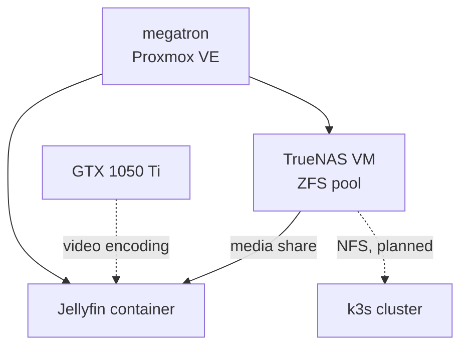

# 🖧 Proxmox

> The lab's hypervisor: one host running Proxmox VE, with the storage server and the media server as guests.

This section is part of my [Homelab](../README.md). The machine itself is described under [hardware](../hardware/README.md#-hypervisor), and how it is reached under [network](../network/README.md).

---

## 📌 Overview

| | |
|---|---|
| **Host** | `megatron` |
| **Platform** | Proxmox VE, managed through its web interface on port `8006` |
| **Hardware** | HP Pavilion desktop, AMD Ryzen 7 (5000 series), 16 GB of memory, 1 TB of storage |
| **GPU** | NVIDIA GeForce GTX 1050 Ti |

Proxmox runs the workloads that do not fit the Kubernetes nodes: the ones that need a GPU, a lot of disk, or a full operating system of their own. The k3s cluster runs on separate bare-metal machines, so a problem on the hypervisor does not take the cluster down, and the other way round.

---

## 🧩 Guests

| Guest | Type | Purpose | Details |
|---|---|---|---|
| **TrueNAS** | Virtual machine | ZFS storage, shared over NFS and SMB | [truenas/](truenas/README.md) |
| **Jellyfin** | LXC container | Media server with GPU video encoding | [jellyfin/](jellyfin/README.md) |

---

## 🤔 VM or Container

Proxmox can run a guest either way, and the two guests here show when each fits.

| | Virtual machine | LXC container |
|---|---|---|
| **What it is** | A full computer with its own kernel | An isolated environment sharing the host's kernel |
| **Overhead** | Higher: memory is reserved for the guest | Lower: close to running on the host |
| **Used here for** | TrueNAS, which is its own operating system and needs direct control of its disks | Jellyfin, which is a single Linux application |

---

## 🔗 How It Connects to the Rest of the Lab

- **Network.** The host and its guests sit on the lab subnet behind OPNsense, alongside the cluster nodes.
- **Storage.** TrueNAS is the lab's network storage. Its NFS service is what will let pods on different cluster nodes share the same files; the cluster is not using it yet.
- **Remote access.** The Proxmox, TrueNAS and Jellyfin interfaces are reachable over Tailscale, with no ports opened to the internet.

---

## 🔭 Next Steps

- [ ] Record each guest's allocated cores, memory and disk
- [ ] Back up guest configurations and schedule VM backups
- [ ] Hostnames for the Proxmox, TrueNAS and Jellyfin interfaces under `.home.lan`
