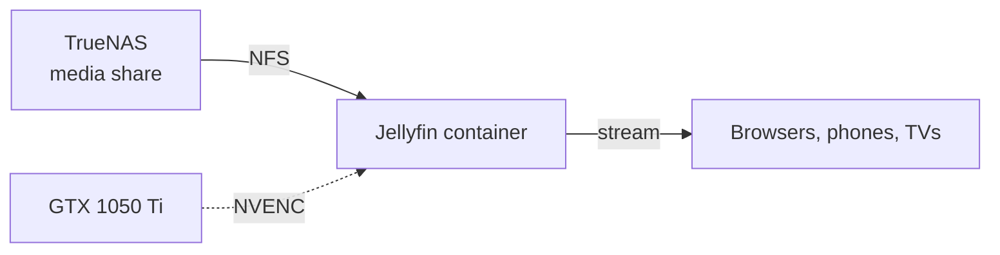

# 🎬 Jellyfin

> A self-hosted media server running in an LXC container on Proxmox, with video encoding handled by the host's GPU.

This is a guest on the [Proxmox host](../README.md), part of my [Homelab](../../README.md).

---

## 📌 Overview

| | |
|---|---|
| **Runs as** | LXC container on `megatron` |
| **Version** | Jellyfin `10.11.11` |
| **Web interface** | Port `8096` |
| **Video encoding** | NVIDIA GeForce GTX 1050 Ti, using NVENC |
| **Media library** | A share on [TrueNAS](../truenas/README.md) |

---

## 🎯 What It Does

Jellyfin organises a media library and streams it to browsers, phones and TVs. It is fully self-hosted, with no account or licence tied to an outside service.

---

## ⚡ Hardware Encoding

When a device cannot play a file as it is, because of its format, resolution or bitrate, Jellyfin converts it on the fly. That conversion is called transcoding.

| | CPU transcoding | GPU transcoding (NVENC) |
|---|---|---|
| **Load** | Can use every core for a single stream | Handled by the graphics card's dedicated encoder |
| **Effect on other guests** | Slows everything else on the host | Leaves the CPU free |
| **Streams at once** | Few | Several |

The GTX 1050 Ti in `megatron` is there for this job. It is the reason Jellyfin runs on the Proxmox host instead of on the Kubernetes nodes, which have no GPU.

---

## 🧩 Why a Container

Jellyfin is a single Linux application, so it does not need a full virtual machine. An LXC container shares the host's kernel, which keeps overhead low and lets the container use the host's GPU through the host's own driver, without dedicating the card to one VM.

---

## 🔗 How It Fits In

---

## 🔭 Next Steps

- [ ] Record the container's allocated cores, memory and disk
- [ ] A `.home.lan` hostname in place of the port
- [ ] An uptime check in Uptime Kuma
